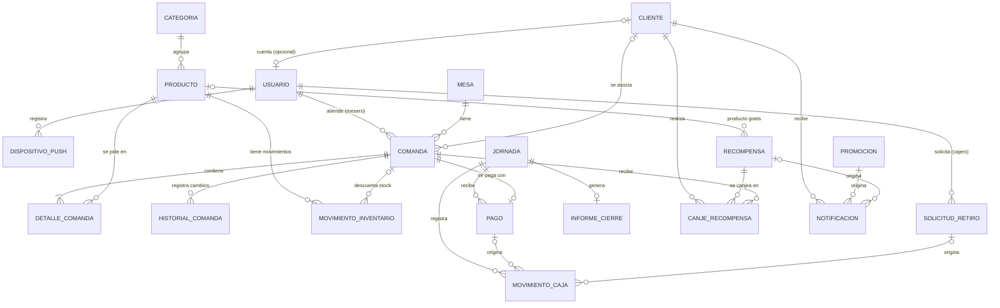

# Modelo de datos básico — Appresso

Entidades JPA del backend (`backend/src/main/java/com/appresso/backend/`), organizadas por módulo (RNF-27).
Son **21 entidades** y **11 enumeraciones**. Este documento es el mapa; el detalle de cada campo está en el código.

> Estado: solo el **modelo** (clases). Las tablas todavía no se crean en PostgreSQL (`ddl-auto=none`); eso lo resuelve la subtarea de migraciones. En las pruebas, Hibernate sí crea las tablas en H2 para validar el mapeo.

## Diagrama

## Entidades por módulo

| Módulo (paquete) | Entidad | Para qué sirve | Requisitos |
|---|---|---|---|
| `usuarios` | `Usuario` | Cuenta con correo, hash de contraseña, rol, bloqueo por intentos fallidos | RF-01 a RF-05, RNF-05, RNF-26 |
| | `DispositivoPush` | Token FCM del dispositivo del administrador | RF-35 |
| `inventario` | `Categoria` | Agrupa productos | RF-06 |
| | `Producto` | Catálogo, precio, stock y umbral mínimo | RF-06, RF-08 a RF-13 |
| | `MovimientoInventario` | Entradas, salidas, ventas y mermas con responsable | RF-07, RF-14 |
| `comandas` | `Mesa` | Mapa de mesas y su estado | RF-15 |
| | `Comanda` | Pedido de una mesa, con subtotal, descuento y total | RF-15 a RF-22 |
| | `DetalleComanda` | Producto, cantidad, precio al momento y observaciones (máx. 100) | RF-16, RF-20, RF-21 |
| | `HistorialComanda` | Cambios de estado y modificaciones (no se edita) | RF-27 |
| `caja` | `Jornada` | Apertura y cierre de caja, base de la siguiente jornada | RF-44, RF-47, RF-49 |
| | `Pago` | Pago de una comanda (efectivo o transferencia) | RF-28 a RF-30, RF-43 |
| | `MovimientoCaja` | Libro de pagos, ingresos y retiros (no se edita) | RF-31 a RF-33, RF-37 |
| | `SolicitudRetiro` | Retiro pedido por el cajero, pendiente de aprobación | RF-34, RF-36 |
| | `InformeCierre` | Informe guardado al cerrar la jornada | RF-45, RF-48 |
| | `ConfiguracionEstablecimiento` | Datos del local y QR de pago (una sola fila) | RF-40 |
| `fidelizacion` | `Cliente` | Datos del cliente, aceptación de la Ley 1581 y racha | RF-50 a RF-52, RF-55 |
| | `Recompensa` | Recompensa con su nivel de racha | RF-54, RF-60 |
| | `Promocion` | Promoción con vigencia | RF-60, RF-62 |
| | `CanjeRecompensa` | Canje confirmado | RF-59 |
| | `Notificacion` | Aviso al cliente | RF-61 |
| `auditoria` | `RegistroAuditoria` | Quién hizo qué y cuándo (no se edita) | RNF-12 |

## Decisiones de diseño

- **Un solo rol por usuario** (`Rol`: administrador, cajero, mesero, cocinero, cliente).
- **Los saldos no se guardan, se calculan.** El saldo de efectivo y de transferencias sale de sumar `MovimientoCaja` por medio de pago. Así no pueden descuadrarse (RF-31).
- **`MovimientoCaja.valor` siempre es positivo**; el tipo (`PAGO`, `INGRESO`, `RETIRO`) define si suma o resta.
- **Una comanda, un pago:** `Pago.comanda` es único en la base de datos (RF-28, RF-43).
- **`identificadorOperacion` (UUID único)** en `Comanda` y `Pago`: permite reintentar sin duplicar después de una caída de red (RNF-11, RNF-22).
- **`DetalleComanda.precioUnitario`** guarda el precio del momento; si el producto cambia de precio, las comandas viejas no cambian.
- **Registros inmutables** (`@Immutable`): `HistorialComanda`, `MovimientoInventario`, `MovimientoCaja`, `RegistroAuditoria`. Falta reforzarlo en la base (permisos o triggers) más adelante.
- **Estado de cocina y pago van separados:** `EstadoComanda` solo cubre el flujo de cocina; si está pagada lo dice la existencia de su `Pago`.
- **Dinero:** `BigDecimal` con 2 decimales. **Fechas y horas:** `Instant` (UTC); fechas sin hora: `LocalDate`.

## Puntos abiertos (hay que decidirlos con el equipo y el cliente)

1. **Login del cliente.** RF-01 pide correo y contraseña, pero RF-50 registra al cliente solo con nombre, apellido, documento y celular. Por eso `Cliente.usuario` es opcional: sirve con cualquiera de las dos decisiones.
2. **Racha: por día o por pedido, y cuándo se pierde.** El acta dice "por pedido", RF-52 dice "por día distinto" y el README habla de "puntos". El modelo guarda `racha` y `ultimaVisita`, que alcanzan para las dos reglas "por día"; si se decide otra regla puede haber que cambiarlo.
3. **Recompensas y promociones** están en el modelo porque los requisitos las incluyen, pero el acta las deja fuera del alcance de la v1.0. Falta confirmar el corte.
4. **QR de pago:** se guarda como URL (`qrPagoUrl`). Si se prefiere guardar la imagen en la base, cambia el campo.
5. **Cancelación de comandas:** existe el estado `CANCELADA`, pero no hay requisito que diga cómo se devuelve el stock.
