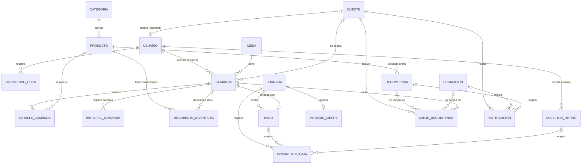

# Modelo de datos básico — Appresso

Entidades JPA del backend (`backend/src/main/java/com/appresso/backend/`), organizadas por módulo (RNF-27).
Son **21 entidades** y **10 enumeraciones**. Este documento es el mapa; el detalle de cada campo está en el código.

> Estado: solo el **modelo** (clases). Las tablas todavía no se crean en PostgreSQL (`ddl-auto=none`); eso lo resuelve la subtarea de migraciones. En las pruebas, Hibernate sí crea las tablas en H2 para validar el mapeo.

## Diagrama

## Entidades por módulo

| Módulo (paquete) | Entidad | Para qué sirve | Requisitos |
|---|---|---|---|
| `usuarios` | `Usuario` | Cuenta con correo, hash de contraseña, rol, bloqueo por intentos fallidos | RF-01 a RF-05, RNF-05, RNF-26 |
| | `DispositivoPush` | Token FCM del dispositivo del administrador | RF-35 |
| `inventario` | `Categoria` | Agrupa productos | RF-06 |
| | `Producto` | Catálogo, precio, stock y umbral mínimo | RF-06, RF-08 a RF-13 |
| | `MovimientoInventario` | Entradas, salidas, ventas y mermas con responsable | RF-07, RF-14 |
| `comandas` | `Mesa` | Mapa de mesas y su estado | RF-15 |
| | `Comanda` | Pedido de una mesa, con subtotal, descuento y total | RF-15 a RF-22 |
| | `DetalleComanda` | Producto, cantidad, precio al momento y observaciones (máx. 100) | RF-16, RF-20, RF-21 |
| | `HistorialComanda` | Cambios de estado y modificaciones (no se edita) | RF-27 |
| `caja` | `Jornada` | Apertura y cierre de caja, base de la siguiente jornada | RF-44, RF-47, RF-49 |
| | `Pago` | Pago confirmado de una comanda (efectivo o transferencia) y quién lo confirmó | RF-28 a RF-30, RF-43 |
| | `MovimientoCaja` | Libro de pagos, ingresos y retiros (no se edita) | RF-31 a RF-33, RF-37 |
| | `SolicitudRetiro` | Retiro pedido por el cajero, pendiente de aprobación | RF-34, RF-36 |
| | `InformeCierre` | Informe guardado al cerrar la jornada | RF-45, RF-48 |
| | `ConfiguracionEstablecimiento` | Datos del local y QR de pago (una sola fila) | RF-40 |
| `fidelizacion` | `Cliente` | Datos del cliente, aceptación de la Ley 1581 y saldo de puntos | RF-50 a RF-52, RF-55 |
| | `Recompensa` | Recompensa canjeable con puntos: umbral para acceder y costo en puntos | RF-54, RF-60 |
| | `Promocion` | Promoción temporal (p. ej. 2x1) con vigencia y costo en puntos | RF-60, RF-62 |
| | `CanjeRecompensa` | Canje confirmado de una recompensa **o** una promoción, con los puntos cobrados | RF-59 |
| | `Notificacion` | Aviso al cliente | RF-61 |
| `auditoria` | `RegistroAuditoria` | Quién hizo qué y cuándo (no se edita) | RNF-12 |

## Decisiones de diseño

- **Un solo rol por usuario** (`Rol`: administrador, cajero, mesero, cocinero, cliente).
- **Los saldos no se guardan, se calculan.** El saldo de efectivo y de transferencias sale de sumar `MovimientoCaja` por medio de pago. Así no pueden descuadrarse (RF-31).
- **`MovimientoCaja.valor` siempre es positivo**; el tipo (`PAGO`, `INGRESO`, `RETIRO`) define si suma o resta.
- **Una comanda, un pago:** `Pago.comanda` es único en la base de datos (RF-28, RF-43).
- **`identificadorOperacion` (UUID único)** en `Comanda` y `Pago`: permite reintentar sin duplicar después de una caída de red (RNF-11, RNF-22).
- **`DetalleComanda.precioUnitario`** guarda el precio del momento; si el producto cambia de precio, las comandas viejas no cambian.
- **Registros inmutables** (`@Immutable`): `HistorialComanda`, `MovimientoInventario`, `MovimientoCaja`, `RegistroAuditoria`. Falta reforzarlo en la base (permisos o triggers) más adelante.
- **Mesa:** `DISPONIBLE` u `OCUPADA`, como en RF-15. Ese RF también habla de "En atención" como alternativa a "Ocupada"; se usa `OCUPADA`.
- **Estados de la comanda según RF-COMANDA-ESTADO:** `PENDIENTE` (creada, no enviada) → `ENVIADA` → `EN_PREPARACION` → `LISTA` → `CERRADA` (el cajero confirma el pago). El enum solo lista los estados; quién puede hacer cada transición (y el error 400 si no puede) lo valida el servicio. Cada cambio queda en `HistorialComanda` (RF-27). **Lo que ve cocina** son tres de los cinco, con los nombres de RF-18 y RF-19: `ENVIADA` se muestra "Pendiente", `EN_PREPARACION` "En preparación" y `LISTA` "Lista". `PENDIENTE` (no enviada) y `CERRADA` no aparecen en cocina (RF-17).
- **Un `Pago` existe solo si está confirmado.** No hay `EstadoPago`. El "pago pendiente de confirmar" de RF-41 es un paso de la pantalla, no un registro: el cliente pide pagar por transferencia, el mesero muestra el QR y, cuando verifica el comprobante, él o el cajero pulsa "Confirmar"; solo entonces se crea el `Pago`, con su fecha y quién lo confirmó (RF-28, RF-30, RF-41). No hay pasarela de pagos. Así una transferencia sin verificar no bloquea la comanda (`Pago.comanda` es único). Una comanda está pagada cuando tiene su `Pago` y en ese momento pasa a `CERRADA`.
- **Fidelización por puntos, no por racha.** El cliente guarda un saldo (`Cliente.puntos`): +1 por cada pago confirmado (RF-52) y se descuenta al canjear (RF-59). Los puntos **no vencen** (el acta no lo contempla; si algún día vencen, habrá que agregar fechas o un libro de movimientos de puntos). Se guarda el saldo y no se calcula porque RF-55 pide consultarlo rápido; el historial de lo gastado queda en `CanjeRecompensa`.
- **Ofertas configurables por el dueño:** `Recompensa` y `Promocion` se canjean con puntos. `Recompensa` tiene `puntosMinimos` (umbral para acceder) y `costoPuntos` (lo que se descuenta). `Promocion` es un evento temporal con vigencia y su propio `costoPuntos`. Una oferta que el dueño elimina se **desactiva** (`activa = false`) y no se borra, porque los canjes antiguos la referencian.
- **`CanjeRecompensa` cubre recompensas y promociones:** exactamente una de las dos (`recompensa` o `promocion`) y guarda `puntosDescontados`, porque el costo de la oferta puede cambiar después. El nombre se mantuvo para no mover la tabla; se puede renombrar a `Canje` en las migraciones.
- **El umbral de una recompensa (`puntosMinimos`) es único solo entre las activas** (RF-54). Por eso no tiene `unique` en la base: lo valida el servicio, o un índice parcial en las migraciones.
- **Dinero:** `BigDecimal` con 2 decimales. **Fechas y horas:** `Instant` (UTC); fechas sin hora: `LocalDate`.
- **Zona horaria del negocio: `America/Bogota`** (UTC-5, sin horario de verano). Los instantes se guardan siempre en UTC (`hibernate.jdbc.time_zone=UTC`), pero "hoy" (jornada de caja, vigencia de promociones) se calcula en Bogotá. La zona está en `appresso.zona-horaria` (`application.properties`) y el código obtiene la fecha y hora actuales del bean `Clock` de `ZonaHorariaConfig`, no de `LocalDate.now()`. Ejemplo: una compra a las 8 pm del 1 de diciembre en Bogotá es el 2 de diciembre en UTC; para el negocio sigue siendo el 1.

## Puntos abiertos (hay que decidirlos con el equipo y el cliente)

1. **Login del cliente.** RF-01 pide correo y contraseña, pero RF-50 registra al cliente solo con nombre, apellido, documento y celular. Por eso `Cliente.usuario` es opcional: sirve con cualquiera de las dos decisiones.
2. **Tipo de beneficio de las promociones.** `Promocion` guarda título, descripción y condiciones como texto libre más su costo en puntos. Si el sistema debe calcular solo el descuento (2x1, porcentaje, valor fijo), hace falta un tipo estructurado, como el de `Recompensa`.
3. **QR de pago:** se guarda como URL (`qrPagoUrl`). Si se prefiere guardar la imagen en la base, cambia el campo.
4. **Cancelación de comandas.** No está en ningún RF ni historia de usuario, y RF-COMANDA-ESTADO dice que el estado tiene "cinco valores" sin cancelada. Pero el entregable 4.2.2 de la EDT (y su diccionario, cronograma, presupuesto y RACI) sí la incluye: "el mesero o administrador anula una comanda activa, revirtiendo el descuento de stock y actualizando el estado en todos los dispositivos"; la comanda cancelada desaparece de cocina. El modelo todavía no la representa. Hay que decidir (a) si es un sexto estado `CANCELADA` (y se actualiza RF-COMANDA-ESTADO) o campos aparte (`cancelada`, quién, cuándo, motivo) que dejen los cinco estados intactos, (b) en qué estados se puede cancelar, y (c) qué pasa con los puntos si la comanda tenía un canje aplicado.
5. **Recompensa solicitada (RF-56).** El cliente solicita una recompensa mientras se crea la comanda y esta la muestra como "Recompensa solicitada, pendiente de aplicar" hasta que el mesero la aplica (RF-58). `CanjeRecompensa` solo existe con el canje ya confirmado, así que no hay dónde guardar esa solicitud.
6. **Recompensa "usada" (RF-59).** Hoy se deduce de la existencia de un `CanjeRecompensa` en una recompensa `usoUnico`. Falta decidir si basta o debe guardarse.
7. **Texto de RF-COMANDA-ESTADO:** ya aclarado en el Documentation-Repo (cocina muestra `enviada` como "Pendiente"); queda por revisar con el equipo.
